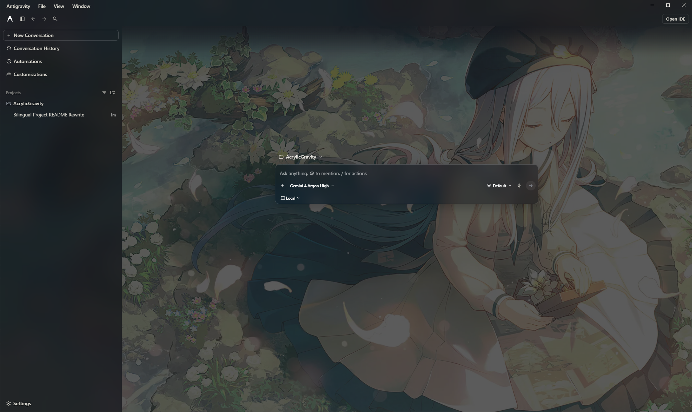
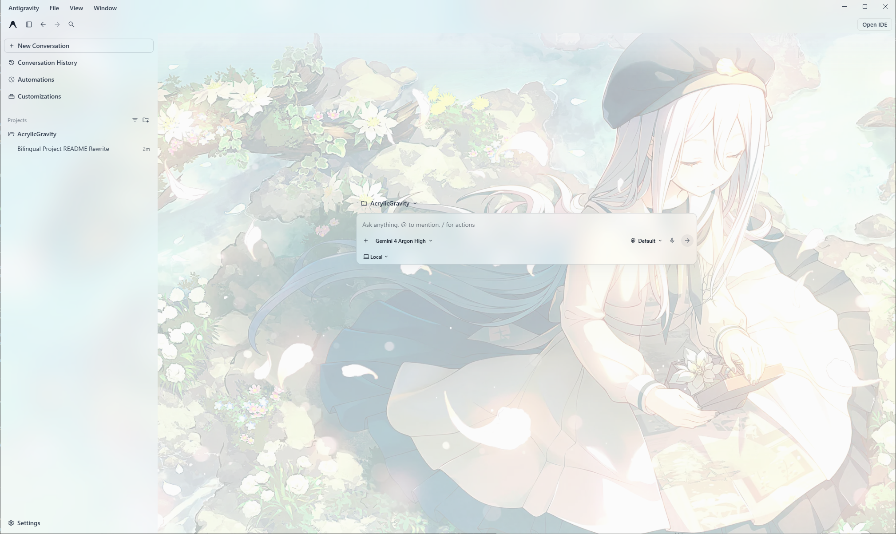

# AcrylicGravity

[English](README.md) | 简体中文

适用于 Windows 版 Antigravity 桌面客户端的亚克力（毛玻璃）主题补丁。

提供多层磨砂背景、半透明侧边栏、对话区与弹窗样式优化，并自动跟随客户端的明暗主题切换。壁纸、模糊度与阅读底色等设置可通过内置面板 **Antigravity Settings → AcrylicGravity** 直接修改。

| 暗色主题 | 浅色主题 |
| :---: | :---: |
|  |  |

## 环境要求

- **系统**：Windows
- **运行环境**：Node.js `22.12` 及以上版本（含 `npm`）
- **客户端**：已安装 Antigravity 桌面版（已在 `2.24.0` 验证，默认路径为 `%LOCALAPPDATA%\Programs\antigravity`）

## 安装与还原

请先克隆或下载本仓库到本地。

> [!IMPORTANT]
> 
> 安装与还原过程中会自动关闭并重启 Antigravity，操作前请先保存手头的工作。客户端版本更新后，重新运行一次安装脚本即可。

### 方式一：目录安装（推荐）

将打好补丁的客户端解压到 `resources\app` 目录运行，同时将原版文件备份为 `resources\app.asar.vanilla`。安装速度更快，且在本地修改重编译主题时支持自动热重载。

- **安装**：双击运行 `install-via-folder.bat`
- **还原**：双击运行 `uninstall-folder.bat`

### 方式二：归档安装（打包 `app.asar`）

将补丁直接重新打包进 `resources\app.asar`（同样会将原版备份为 `resources\app.asar.vanilla`）。如果你打算在安装后移动或删除本仓库文件夹，推荐使用此方式。

- **安装**：双击运行 `install-permanent-patch.bat`
- **还原**：双击运行 `restore-original.bat`

### 自定义安装路径

如果你的 Antigravity 没有安装在默认位置，可通过 PowerShell 指定客户端的 `resources` 目录：

```powershell
powershell -NoProfile -ExecutionPolicy Bypass -File scripts/install-theme.ps1 -ResourcesPath "D:\Apps\Antigravity\resources"
```

*（可选参数：追加 `-Mode Asar` 使用归档安装，或追加 `-Mode Restore` 还原为原版。）*

## 开发与构建

`style.css` 和 `injector.js` 是主题的核心源码，编译后会生成独立的注入脚本 `bootstrap.js`：

```powershell
npm ci --ignore-scripts
npm run build
```

- **热重载**：采用“目录安装”时，客户端会监听本仓库下的 `bootstrap.js`，执行 `npm run build` 后会自动刷新主题（若从旧版本升级，可运行一次 `rebuild-theme.bat` 同步）。
- **仅在本地构建（不安装）**：如果只想在 `build/` 目录下生成打好补丁的副本而不改动已安装的客户端：
  ```powershell
  npm run build:app
  node scripts/prepare-app.js --asar
  node scripts/prepare-app.js --source "D:\Backup\app.asar" --asar
  ```
- **可选的守护进程注入**：如果不希望修改客户端文件，且客户端已开启 `DevToolsActivePort`，可运行 `start.bat`（或静默启动 `start-silent.vbs`）通过 `daemon.js` 在运行时注入主题；运行 `stop.bat` 即可停止。
